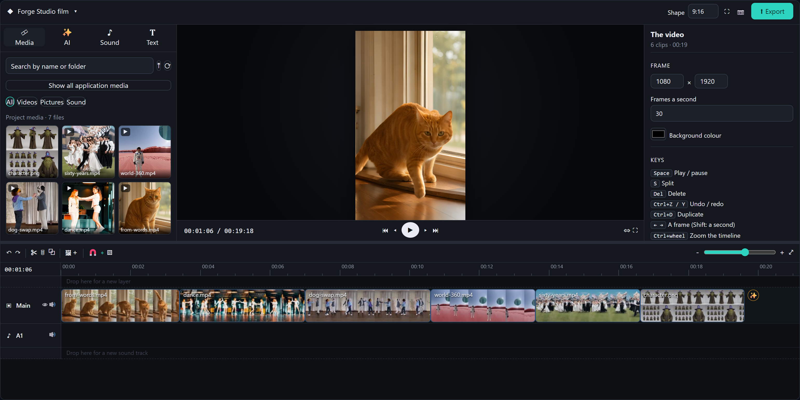
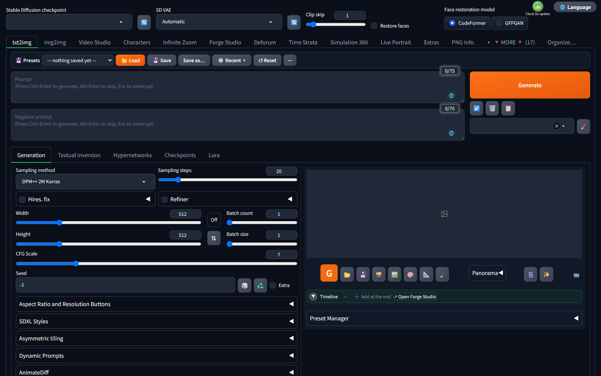
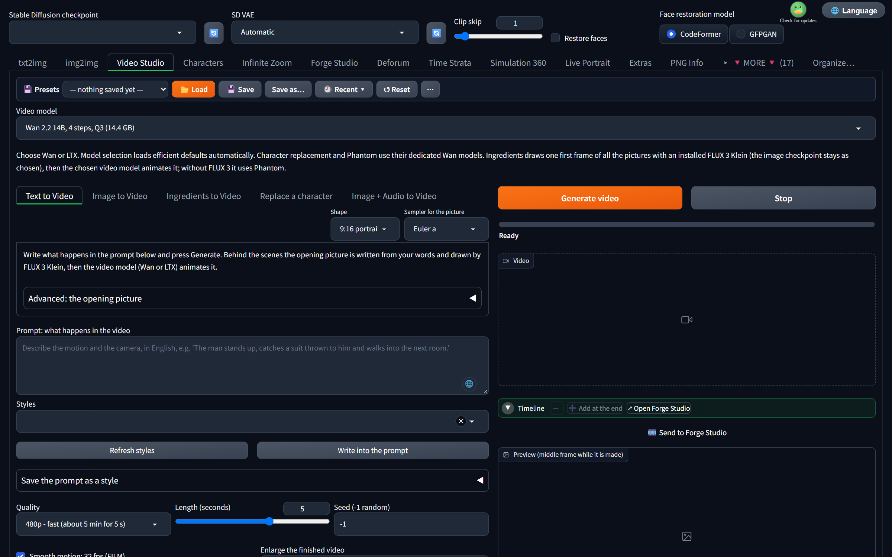

# Forge Studio for Pinokio

A 1-click launcher for [Forge Studio](https://github.com/Shai7net/forge-studio): an AI creative studio built on
Stable Diffusion WebUI Forge for one PC with an 8 GB NVIDIA card (FLUX 3, FIBO 2.0, SDXL / SD 1.5, Wan 2.2, LTX 2.3 and MiniMax-H3 video,
AnimateDiff, Deforum, Simulation 360, Time Strata, Characters, a timeline video editor and a prompt writer for any
language).

**Windows 10/11 and an NVIDIA card with 8 GB or more only** (like Forge Studio itself).

## What's new (0.1.8)

- **MiniMax-H3 FL2V · W4A8 · 8 GB** in Video Studio, beside Wan 2.2 and LTX 2.3: text, image and first + last frame
  video on an 8 GB card. In Video Studio → Models: download its files and press *Set up MiniMax-H3 engine* (after
  FIBO 2.0's engine).
- **Image + Audio to Video** picks LTX by itself and makes the whole recording, even longer than 8 seconds; length,
  shape and frame rate come from your picture or video.
- **Editor**: ⏪ Reverse in a clip's right-click menu, AI joins between shots that keep every track in step, and 🌐 in
  every prompt box to write the English prompt from Hebrew or any language.
- Smoother playback, Lip sync without stutter, and Stop that really stops an AI job.

Already installed? Press **Update** in Pinokio. All changes: [releases](https://github.com/Shai7net/forge-studio/releases).

## See it

<table>
<tr>
<td width="30%" align="center"><a href="media/forge-studio-film.mp4"></a><br><a href="media/forge-studio-film.mp4"><b>▶ The film (23 s)</b></a><br><sub>Every shot, and the music, made in Forge Studio</sub></td>
<td><a href="media/forge-studio.png"></a><br><sub><b>Forge Studio</b>: the timeline video editor</sub></td>
</tr>
</table>

| | |
|---|---|
| <a href="media/txt2img.png"></a><br><sub><b>txt2img</b>: extension cards, and the timeline under the result</sub> | <a href="media/video-studio.png"></a><br><sub><b>Video Studio</b>: Wan 2.2, LTX 2.3 and MiniMax-H3 video</sub> |

## Use

- **Install**: choose which models to download (recommended, minimal, video, all, or none). The launcher clones
  Forge Studio into `app/` and runs its own installer without questions; the installer brings its own Python 3.10,
  git, uv, ffmpeg and llama.cpp into `app/system` and changes nothing system-wide. About 15 GB plus the models.
- **Start**: runs the server on a free port; **Open Web UI** opens it.
- **Download models**: more models later (a preset or groups such as `sd15,animatediff,controlnet,video,flux3`, see
  `app/installer/models.json`), with an optional Hugging Face token for gated models (FLUX 3 Klein).
- **Update**: this launcher and Forge Studio (its installer runs again with no new models and keeps your settings,
  models and data).
- **Reset**: deletes `app/` (models and outputs too).

Choices made here: the server gets `--port` from Pinokio because several Forge Studio tabs call the server at its
own port; `SD_WEBUI_RESTARTING=1` keeps Forge from opening a browser of its own.

## API

Forge Studio runs with `--api` (Stable Diffusion WebUI's API). Replace the port with the one Pinokio shows.

```bash
curl -s -X POST http://127.0.0.1:7860/sdapi/v1/txt2img -H "Content-Type: application/json" -d "{\"prompt\": \"a red teapot, product photo\", \"steps\": 20}"
```

```python
import base64, requests
r = requests.post("http://127.0.0.1:7860/sdapi/v1/txt2img", json={"prompt": "a red teapot, product photo", "steps": 20})
open("out.png", "wb").write(base64.b64decode(r.json()["images"][0]))
```

```javascript
const r = await fetch("http://127.0.0.1:7860/sdapi/v1/txt2img", { method: "POST", headers: { "Content-Type": "application/json" },
  body: JSON.stringify({ prompt: "a red teapot, product photo", steps: 20 }) });
const { images } = await r.json();
```

Each tab has its own routes too (`/forge-studio/*`, `/translator/write`, `/ui-skins/*` ...): see the READMEs inside
`app/forge/webui/extensions/`.
